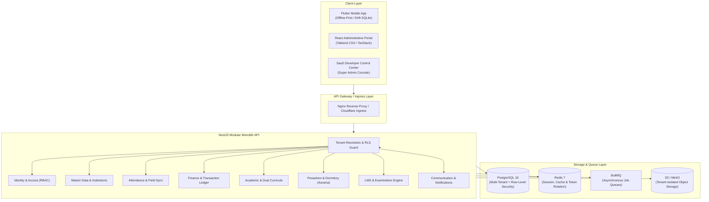
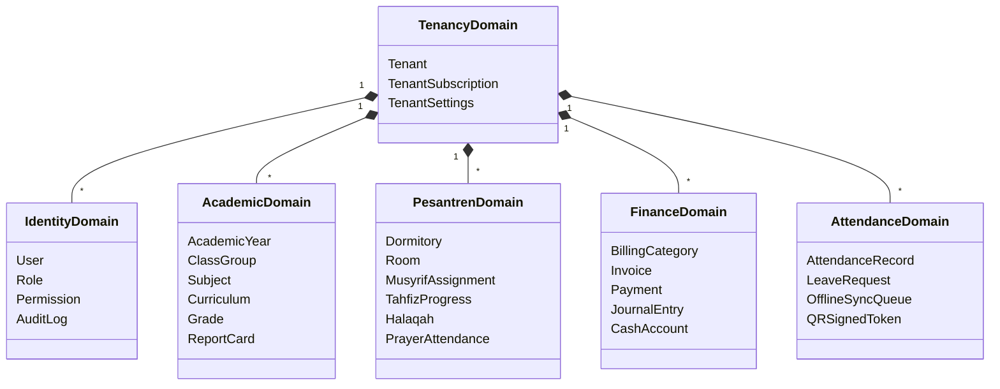

# System Architecture Blueprint

## 1. Architectural Philosophy

The **Integrated School & Pesantren Management SaaS** platform is engineered as a **Modular Monolith** initially, with strict logical domain boundaries. This balances development velocity and operational simplicity while ensuring clean separation of concerns for future microservice or serverless extraction.



---

## 2. Multi-Tenant Architecture

### 2.1 Multi-Tenancy Model
The platform employs a **Shared Database, Shared Schema with Row-Level Security (RLS)** architecture for standard tiers, with an abstraction layer supporting **Dedicated Database routing** for enterprise institutions.

1. **Unique Institution Identifier**: Every tenant is identified by a immutable `tenant_id` (UUIDv4).
2. **Mandatory Column Ownership**: Every business entity table in the database contains a non-nullable `tenant_id` foreign key referencing the `tenants` table.
3. **Database-Level Defense in Depth (PostgreSQL RLS)**:
   - Application database transactions execute with session settings:
     ```sql
     SET LOCAL app.current_tenant_id = '<authenticated-tenant-uuid>';
     ```
   - RLS policies automatically filter queries so that records outside the tenant boundary are invisible:
     ```sql
     CREATE POLICY tenant_isolation_policy ON students
         FOR ALL
         USING (tenant_id = current_tenant_id() OR is_super_admin_bypass());
     ```
4. **Application-Level Defense (NestJS Guards & Interceptors)**:
   - Frontend requests must convey the tenant identity either via authenticated JWT claims (`tenant_id`), custom subdomain (`slug.edusaas.id`), or header `X-Tenant-ID`.
   - The backend `TenantInterceptor` validates tenant status (active, suspended, trial expired) and binds tenant context to the asynchronous execution context (`AsyncLocalStorage`).
5. **Zero Trust on Frontend**: The frontend is treated strictly as an untrusted client. No frontend filtering can substitute for database and backend tenant enforcement.

---

## 3. Domain Boundaries

The application is decomposed into cohesive, loosely coupled domain modules:



### Module Responsibilities:
1. **Core Tenancy**: Tenant onboarding, subscription quotas, module feature flags, custom branding.
2. **Identity & Access Management (IAM)**: Authentication (JWT + refresh token rotation), RBAC, permission overrides, audit trails.
3. **Master Data**: Institutions, departments, teachers, staff, students, guardians, relationship mapping.
4. **Attendance & Field Sync**: Mobile QR scanning, signed token verification, offline sync ingest, geo-fencing.
5. **Financial Ledger**: Double-entry journal records, automated invoicing, multi-gateway payment webhooks (QRIS, VA), idempotency keys.
6. **Academic & Dual Curricula**: Formal school grading + Pesantren Islamic studies, teacher assignments, report card generation.
7. **Pesantren Operations**: Dormitory room allocations, Tahfiz juz/surah milestones, halaqah groups, diniyah classes, student leaves.
8. **Learning Management (LMS)**: Course materials, assignment distribution, online examination engine, question banks.
9. **Communication & Alerts**: Notification dispatch (FCM, in-app, WhatsApp), complaint ticketing, parent feedback.
10. **Developer Control Center**: SaaS metric aggregation, tenant health, system logs, version distribution.

---

## 4. Request Lifecycle & Execution Pipeline

```mermaid
sequenceDiagram
    autonumber
    actor Client as Mobile / Web Client
    participant Proxy as Reverse Proxy
    participant Guard as Tenant & Auth Guards
    participant Service as Domain Service
    participant RLS as PostgreSQL (RLS Context)
    participant Redis as Redis Cache / Queue

    Client->>Proxy: HTTPS Request (Bearer JWT + Tenant Header)
    Proxy->>Guard: Validate SSL, Pass Headers
    Guard->>Guard: Verify JWT Signature & Expiry
    Guard->>Guard: Extract tenant_id & user permissions
    Guard->>RLS: BEGIN; SET LOCAL app.current_tenant_id = 'uuid';
    Guard->>Service: Execute Domain Method
    alt Read Cache Hit
        Service->>Redis: Get cached resource
        Redis-->>Service: Return payload
    else Database Query
        Service->>RLS: Query with RLS active
        RLS-->>Service: Tenant-isolated rows
    end
    Service->>RLS: COMMIT;
    Service-->>Client: Standardized JSON Response Envelope
```

---

## 5. Horizontal Scaling & High Availability

1. **Stateless API Tier**:
   - Backend NestJS processes maintain zero in-memory session state.
   - All ephemeral sessions, rate-limit counters, and blacklist tokens reside in Redis.
   - Additional container replicas can be spun up behind a load balancer without session affinity requirements.
2. **Database Optimization**:
   - Primary write node with read replicas for analytical queries and heavy report generation.
   - Compound indexes: `(tenant_id, created_at)`, `(tenant_id, status)`, `(tenant_id, student_id)`.
   - Table partitioning strategy designed for high-volume attendance and audit log tables by academic year / date range.
3. **Queue Distribution (BullMQ)**:
   - Resource-intensive workloads (PDF report generation, bulk notification dispatch, batch invoicing, image transcoding) are decoupled into asynchronous Redis queues.
