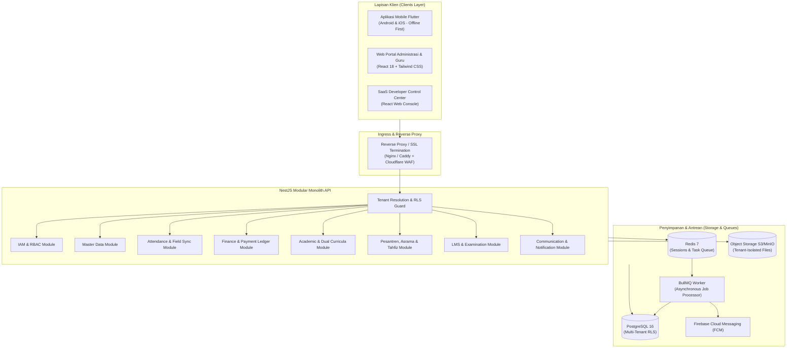
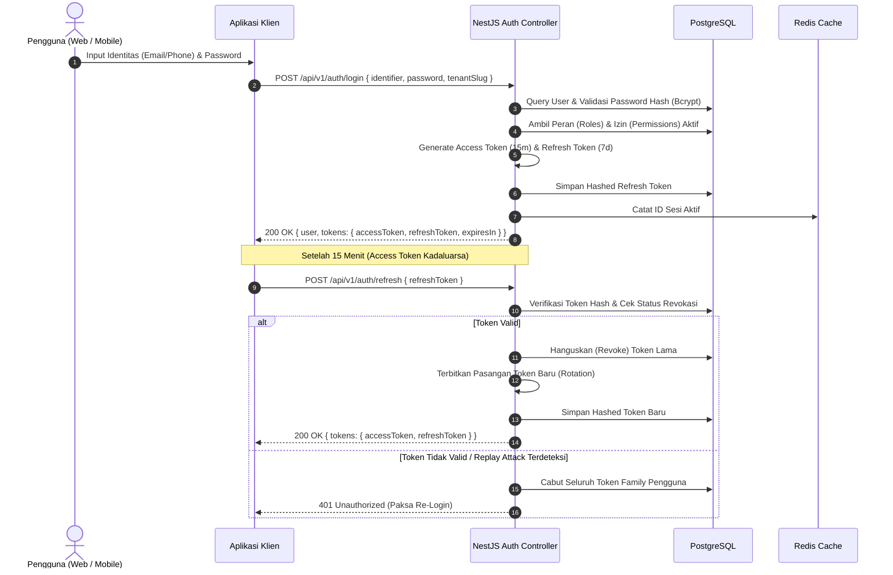
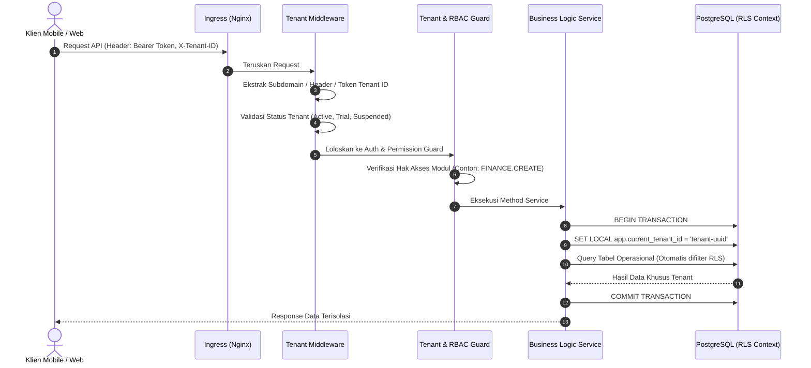
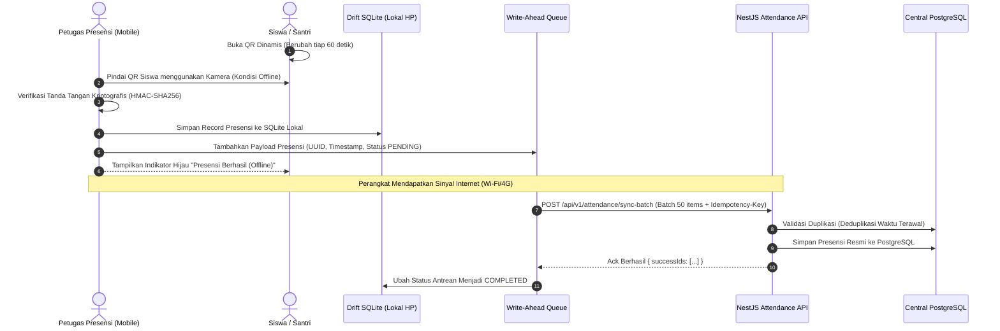
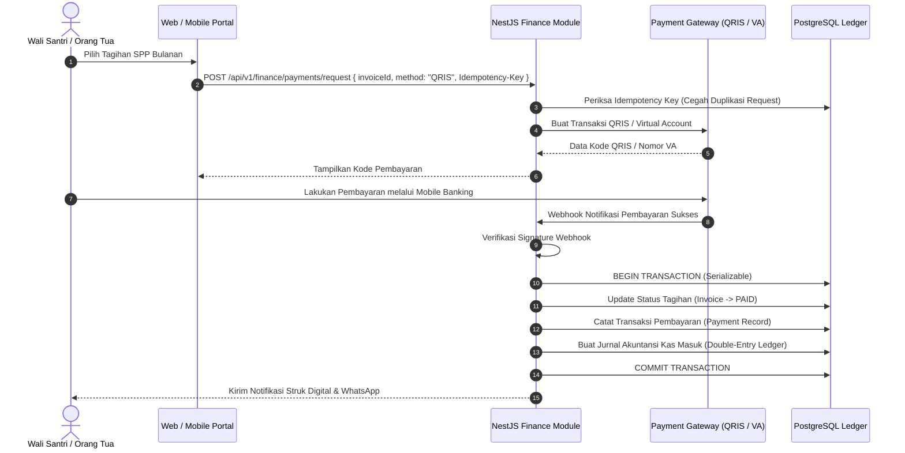
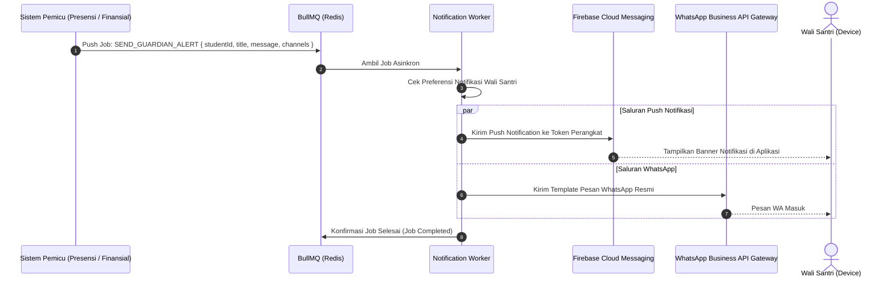
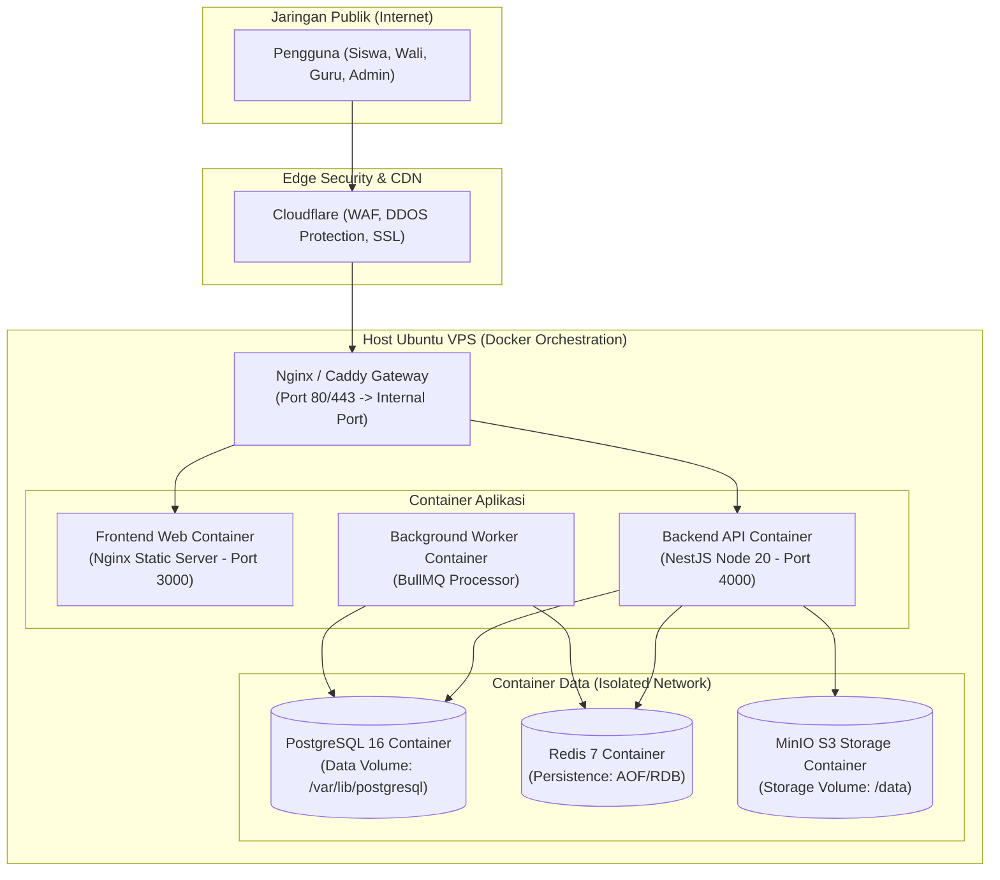

# Architecture Diagrams & Visual Workflows

Dokumen ini memuat diagram alur teknis komprehensif menggunakan format standar **Mermaid** untuk memvisualisasikan seluruh alur kerja inti sistem.

---

## 1. Diagram Arsitektur Sistem Menyeluruh (System Architecture)

---

## 2. Alur Autentikasi & Refresh Token Rotation (Authentication Flow)

---

## 3. Siklus Hidup Request Multi-Tenant (Tenant Request Lifecycle)

---

## 4. Alur Presensi Offline & Sinkronisasi Lapangan (Attendance Synchronization)

---

## 5. Alur Pembayaran Finansial & Idempotensi (Financial Payment Flow)

---

## 6. Alur Pengiriman Notifikasi Multi-Channel (Notification Delivery)

---

## 7. Topologi Deployment Infrastruktur Produksi (Deployment Topology)

