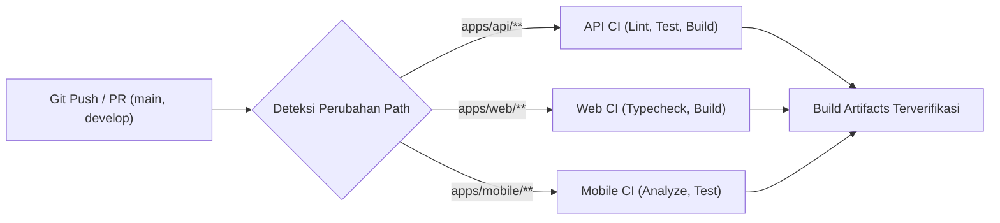

# Panduan Otomatisasi CI/CD & GitHub Actions

## 1. Arsitektur Pipeline CI/CD

Platform menggunakan **GitHub Actions** dengan pipeline terpisah berbasis *path-filtering* untuk efisiensi komputasi runner:

### Daftar Workflow:
1. [`.github/workflows/api-ci.yml`](file:///c:/aplikasi%20baru/.github/workflows/api-ci.yml): Validasi skema Prisma, generate client, pengujian unit test NestJS, dan kompilasi build API.
2. [`.github/workflows/web-ci.yml`](file:///c:/aplikasi%20baru/.github/workflows/web-ci.yml): Typechecking TypeScript dan kompilasi bundle produksi React Vite.
3. [`.github/workflows/mobile-ci.yml`](file:///c:/aplikasi%20baru/.github/workflows/mobile-ci.yml): Format check Dart, analisis statis Flutter (`flutter analyze`), dan eksekusi widget test.

---

## 2. Kebutuhan GitHub Repository Secrets

Berikut adalah daftar rahasia (*secrets*) yang wajib dikonfigurasikan oleh pemilik repositori pada menu **Settings > Secrets and variables > Actions**:

| Nama Secret | Deskripsi / Penggunaan | Status Saat Ini |
| :--- | :--- | :--- |
| `VPS_HOST` | Alamat IP atau hostname Ubuntu VPS target | Wajib ditambahkan saat deployment |
| `VPS_USERNAME` | Akun pengguna SSH pada VPS (misal: `ubuntu` / `deployer`) | Wajib ditambahkan saat deployment |
| `VPS_SSH_KEY` | Private SSH Key (ed25519) untuk deployment otomatis | Wajib ditambahkan saat deployment |
| `DOCKERHUB_USERNAME` | Akun Docker Hub / Container Registry | Opsional untuk image registry |
| `DOCKERHUB_TOKEN` | Access Token Docker Hub | Opsional untuk image registry |
| `PRODUCTION_ENV` | Berkas konfigurasi `.env` lingkungan produksi | Terenkripsi via GitHub Secrets |

> [!IMPORTANT]
> Jangan pernah mencantumkan nilai rahasia asli di dalam file kode sumber atau repositori publik.
