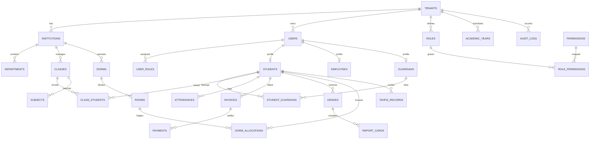

# Database Architecture & Schema Specification

## 1. Overview & Principles

The database engine is **PostgreSQL 16**. The schema is designed for multi-tenant scalability, strict referential integrity, financial auditability, and compliance with high-concurrency educational requirements (1,000–3,000 students per institution initially, horizontally scalable).

### Core Database Rules:
1. **Primary Keys**: Every table uses a cryptographically secure **UUIDv4** as its primary key (`id uuid PRIMARY KEY DEFAULT gen_random_uuid()`).
2. **Tenant Scoping**: All operational tables contain a mandatory `tenant_id uuid NOT NULL REFERENCES tenants(id) ON DELETE RESTRICT`.
3. **Compound Tenant Indexes**: Primary query paths are indexed with compound indexes prefixed by `tenant_id` to ensure sub-millisecond query isolation.
4. **Audit Columns**: Every table includes `created_at timestamptz DEFAULT CURRENT_TIMESTAMP` and `updated_at timestamptz DEFAULT CURRENT_TIMESTAMP`. Soft-deletable records include `deleted_at timestamptz NULL`.
5. **PostgreSQL Row-Level Security (RLS)**: Enforced as database-level defense-in-depth.

---

## 2. Entity-Relationship Architecture (28 Core Domains)



---

## 3. Schema Definitions by Functional Area

### 3.1 Multi-Tenancy & Subscriptions
- `tenants`: Root identity of educational institutions (`id`, `name`, `subdomain`, `custom_domain`, `status`, `created_at`).
- `tenant_subscriptions`: Subscription package, billing tier, student quota, module activations, start/end date.
- `tenant_settings`: Branding (logo, primary color), academic settings, currency format, timezone, contact info.

### 3.2 Identity, Access & Audit
- `users`: User authentication entity (`id`, `tenant_id`, `email`, `phone`, `password_hash`, `mfa_enabled`, `is_active`, `last_login_at`).
- `roles`: Role definitions per tenant or global templates (`id`, `tenant_id`, `name`, `slug`, `is_system`).
- `permissions`: Granular actions (`id`, `module`, `action`: view, create, update, delete, approve, export, manage).
- `role_permissions`: Join table linking roles to permissions.
- `user_roles`: Many-to-many relationship supporting multi-role user accounts.
- `audit_logs`: Immutable security ledger (`id`, `tenant_id`, `user_id`, `action`, `resource`, `resource_id`, `old_values`, `new_values`, `ip_address`, `user_agent`, `created_at`).

### 3.3 People & Guardian Relationships
- `guardians`: Parent/guardian master profile (`id`, `tenant_id`, `user_id`, `nik`, `occupation`, `address`, `income_bracket`).
- `students`: Student/santri profile (`id`, `tenant_id`, `user_id`, `nis`, `nisn`, `full_name`, `gender`, `birth_place`, `birth_date`, `blood_type`, `admission_year`, `status`).
- `student_guardians`: Multi-to-multi guardian mapping (`id`, `tenant_id`, `student_id`, `guardian_id`, `relationship_type`, `is_primary`, `has_financial_access`, `is_emergency_contact`).
- `employees`: Teachers and administrative staff profile (`id`, `tenant_id`, `user_id`, `nip`, `full_name`, `employment_status`, `position`).

### 3.4 Academic & Dual Curricula
- `institutions`: Sub-units (e.g., SMP, SMA, SMK, MTs, MA, Pesantren).
- `academic_years`: School years with active status (`id`, `tenant_id`, `name`, `semester`, `start_date`, `end_date`, `is_active`).
- `classes`: Classes/rombongan belajar (`id`, `tenant_id`, `institution_id`, `academic_year_id`, `name`, `grade_level`, `homeroom_teacher_id`).
- `class_students`: Student enrollment per class and academic year.
- `subjects`: Formal subjects & pesantren subjects (`id`, `tenant_id`, `institution_id`, `code`, `name`, `curriculum_type`: FORMAL / PESANTREN).
- `grades`: Student grades (`id`, `tenant_id`, `student_id`, `subject_id`, `class_id`, `component`: DAILY, MID_EXAM, FINAL_EXAM, `score`, `weight`).
- `report_cards`: Generated semester reports with final scores, remarks, rankings, and signed PDF metadata.

### 3.5 Pesantren, Dormitory & Tahfiz
- `dormitories`: Dormitory buildings / asrama (`id`, `tenant_id`, `name`, `gender_type`: MALE / FEMALE, `capacity`).
- `dorm_rooms`: Rooms in dormitory (`id`, `tenant_id`, `dormitory_id`, `room_number`, `capacity`).
- `dorm_allocations`: Student room assignments with start/end dates.
- `musyrif_assignments`: Supervisors assigned to rooms or dorm blocks.
- `tahfiz_records`: Quran memorization logs (`id`, `tenant_id`, `student_id`, `musyrif_id`, `surah_number`, `ayat_start`, `ayat_end`, `juz`, `fluency_rating`, `status`: ZIYADAH / MUROJA'AH).
- `halaqah_groups`: Study circles for religious / Quranic studies.

### 3.6 Attendance & Offline Sync Tokens
- `attendances`: Unified attendance records (`id`, `tenant_id`, `student_id` or `employee_id`, `type`: CLASS, DORM, PRAYER, ACTIVITY, `status`: PRESENT, LATE, SICK, PERMISSION, ABSENT, `check_in_time`, `check_out_time`, `method`: QR_SCAN, MANUAL, BIOMETRIC, `device_id`, `latitude`, `longitude`).
- `leave_requests`: Leave / dispensation requests with approval workflow (`id`, `tenant_id`, `requester_id`, `reason`, `start_date`, `end_date`, `status`: PENDING, APPROVED, REJECTED, `approved_by`).
- `sync_operations`: Tracking table for mobile offline sync batches to prevent replay attacks and ensure idempotency.

### 3.7 Financial Ledger & Idempotent Transactions
- `billing_categories`: Monthly tuition, admission, uniforms, books, infak, exam fees.
- `invoices`: Generated student billing items (`id`, `tenant_id`, `student_id`, `invoice_number`, `amount`, `due_date`, `status`: UNPAID, PARTIAL, PAID, CANCELLED).
- `payments`: Processed transactions (`id`, `tenant_id`, `invoice_id`, `transaction_code`, `amount_paid`, `method`: CASH, VA, QRIS, BANK_TRANSFER, `gateway_reference`, `idempotency_key`, `paid_at`).
- `journal_entries`: Double-entry accounting records (`id`, `tenant_id`, `entry_date`, `reference_no`, `description`).
- `journal_lines`: Debits and credits per account.
- `cash_accounts`: Bank accounts, petty cash, infak fund accounts.

### 3.8 LMS, Development & Communication
- `lms_courses`, `lms_materials`, `lms_assignments`, `lms_submissions`: Course material distribution & grading.
- `exam_banks`, `exam_schedules`, `exam_attempts`: CBT online examination engine.
- `student_violations`, `student_achievements`, `counseling_records`: Discipline points, achievements, and restricted BK counseling logs.
- `announcements`, `complaint_tickets`, `notification_logs`: Broadcasts and parent-school communication.

---

## 4. Indexing Strategy

To guarantee performance with thousands of students per institution:
- All queries filtering by tenant must utilize indexes starting with `tenant_id`.
- Example indexes:
  ```sql
  CREATE INDEX idx_students_tenant_nis ON students (tenant_id, nis);
  CREATE INDEX idx_attendances_tenant_date ON attendances (tenant_id, recorded_date, status);
  CREATE INDEX idx_invoices_tenant_status ON invoices (tenant_id, status, due_date);
  CREATE INDEX idx_payments_idempotency ON payments (tenant_id, idempotency_key) WHERE idempotency_key IS NOT NULL;
  CREATE INDEX idx_audit_logs_tenant_created ON audit_logs (tenant_id, created_at DESC);
  ```

---

## 5. Migration Strategy

- Migrations are managed strictly using **Prisma Migrate**.
- No production database changes may occur without a migration script committed to version control.
- All migrations must be backward-compatible with the immediately preceding mobile app version.
- Migration commands:
  ```bash
  # Development
  npx prisma migrate dev --name <migration_name>
  # Staging / Production
  npx prisma migrate deploy
  ```
