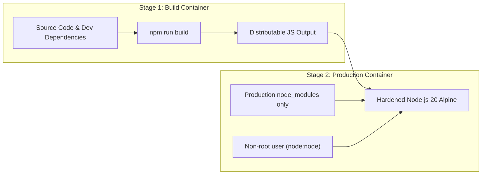
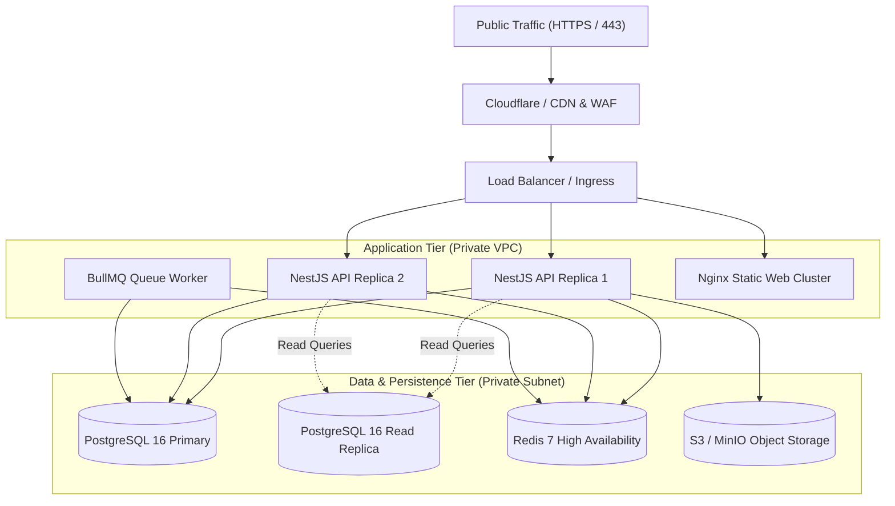

# Deployment Architecture & Operations Guide

## 1. Environments Overview

The platform uses three isolated environments:
1. **Development (`dev`)**: Local developer workstations running Docker Compose. Mock payment gateways, ephemeral test data.
2. **Staging (`stage`)**: Near-production environment for integration testing, client demonstrations, and load testing. Connects to payment gateway sandboxes.
3. **Production (`prod`)**: High-availability, multi-tenant production environment. Strict access controls, automated encrypted backups, continuous performance monitoring.

---

## 2. Containerization Strategy

All server applications are packaged into hardened, minimal Alpine/Debian Linux Docker images using **multi-stage builds**.



### Key Container Hardening Standards:
- Non-root user execution (`USER node`).
- Zero build tools or devDependencies in production images.
- Built-in container health checks (`/api/v1/health`).
- Read-only root filesystem where feasible, with temporary directories mapped to `tmpfs`.

---

## 3. Production Deployment Topologies



---

## 4. Zero-Downtime Deployment & Migration Workflow

To deploy schema changes without impacting running services:

1. **Pre-deployment Migration**:
   - The CI/CD pipeline triggers an ephemeral container to run:
     ```bash
     npx prisma migrate deploy
     ```
   - **Critical Rule**: All migrations must be backward-compatible with the currently running application version (expand before contract).
2. **Rolling Container Update**:
   - The orchestrator spins up healthy new containers with the updated version.
   - Traffic switches to new containers only after health checks return `200 OK`.
   - Old containers are drained and terminated gracefully.

---

## 5. Backup & Disaster Recovery (DR)

1. **Automated Database Backups**:
   - Full PostgreSQL logical backups (`pg_dump`) executed daily at 02:00 UTC and pushed encrypted (GPG / AES-256) to an off-site secondary S3 bucket.
   - Continuous Write-Ahead Logging (WAL) archiving for Point-In-Time Recovery (PITR) up to 14 days.
2. **Recovery Time Objective (RTO) & Recovery Point Objective (RPO)**:
   - **RTO**: Under 2 hours.
   - **RPO**: Under 15 minutes of transactional data.
3. **Restoration Verification Drills**:
   - Monthly automated restoration drills in an isolated staging environment to verify backup integrity.
