# Entity Relationship Diagram (ERD) & Kamus Data

Dokumen ini memuat diagram relasi entitas terperinci (ERD) dan kamus data atribut untuk 34 domain entitas dari platform **Integrated School & Pesantren Management SaaS**.

---

## 1. Diagram Relasi Entitas Lengkap (Comprehensive ERD)

```mermaid
erDiagram
    %% TENANCY & IDENTITY
    TENANTS ||--o{ TENANT_SUBSCRIPTIONS : has
    TENANTS ||--o| TENANT_SETTINGS : configures
    TENANTS ||--o{ USERS : owns
    TENANTS ||--o{ ROLES : defines
    TENANTS ||--o{ AUDIT_LOGS : records
    
    USERS ||--o{ REFRESH_TOKENS : maintains
    USERS ||--o{ USER_ROLES : assigned
    ROLES ||--o{ ROLE_PERMISSIONS : includes
    PERMISSIONS ||--o{ ROLE_PERMISSIONS : mapped
    
    %% MASTER DATA & RELATIONSHIPS
    TENANTS ||--o{ INSTITUTIONS : operates
    INSTITUTIONS ||--o{ DEPARTMENTS : contains
    INSTITUTIONS ||--o{ ACADEMIC_YEARS : schedules
    ACADEMIC_YEARS ||--o{ CLASS_GROUPS : establishes
    
    USERS ||--o| EMPLOYEES : profiles
    USERS ||--o| STUDENTS : profiles
    USERS ||--o| GUARDIANS : profiles
    
    EMPLOYEES ||--o{ CLASS_GROUPS : manages_as_homeroom
    CLASS_GROUPS ||--o{ CLASS_STUDENTS : enrolls
    STUDENTS ||--o{ CLASS_STUDENTS : member_of
    
    STUDENTS ||--o{ STUDENT_GUARDIANS : linked_to
    GUARDIANS ||--o{ STUDENT_GUARDIANS : manages
    
    %% ATTENDANCE & LEAVES
    TENANTS ||--o{ ATTENDANCES : tracks
    STUDENTS ||--o{ ATTENDANCES : checks_in
    STUDENTS ||--o{ LEAVE_REQUESTS : submits
    
    %% FINANCE
    TENANTS ||--o{ BILLING_CATEGORIES : classifies
    BILLING_CATEGORIES ||--o{ INVOICES : categorized_in
    STUDENTS ||--o{ INVOICES : billed
    INVOICES ||--o{ PAYMENTS : settled_by
    TENANTS ||--o{ CASH_ACCOUNTS : owns
    TENANTS ||--o{ JOURNAL_ENTRIES : records
    JOURNAL_ENTRIES ||--o{ JOURNAL_LINES : contains
    CASH_ACCOUNTS ||--o{ JOURNAL_LINES : debits_credits
    
    %% ACADEMIC & DUAL CURRICULA
    INSTITUTIONS ||--o{ SUBJECTS : offers
    STUDENTS ||--o{ GRADES : receives
    SUBJECTS ||--o{ GRADES : evaluated_in
    STUDENTS ||--o{ REPORT_CARDS : receives
    
    %% PESANTREN & DORMITORY
    TENANTS ||--o{ DORMITORIES : owns
    DORMITORIES ||--o{ DORM_ROOMS : contains
    DORM_ROOMS ||--o{ DORM_ALLOCATIONS : assigns
    STUDENTS ||--o{ DORM_ALLOCATIONS : resides_in
    EMPLOYEES ||--o{ MUSYRIF_ASSIGNMENTS : assigned_to
    STUDENTS ||--o{ TAHFIZ_RECORDS : recites
    EMPLOYEES ||--o{ TAHFIZ_RECORDS : mentors
    TENANTS ||--o{ HALAQAH_GROUPS : organizes
    STUDENTS ||--o{ HALAQAH_GROUPS : participates_in
    
    %% STUDENT DEVELOPMENT & COUNSELING
    STUDENTS ||--o{ STUDENT_VIOLATIONS : receives
    STUDENTS ||--o{ STUDENT_ACHIEVEMENTS : earns
    STUDENTS ||--o{ COUNSELING_RECORDS : receives
    
    %% COMMUNICATION & TICKETING
    TENANTS ||--o{ ANNOUNCEMENTS : publishes
    TENANTS ||--o{ COMPLAINT_TICKETS : receives
    USERS ||--o{ COMPLAINT_TICKETS : files
```

---

## 2. Kamus Data 34 Entitas Inti

Berikut daftar entitas lengkap yang dirancang untuk mendukung operasional penuh:

1. **`tenants`**: Identitas utama institusi/yayasan pendidikan (`id`, `name`, `slug`, `subdomain`, `custom_domain`, `status`).
2. **`tenant_subscriptions`**: Paket langganan SaaS, kuota santri, dan status aktif.
3. **`tenant_settings`**: Konfigurasi branding, warna tema, zona waktu, format mata uang, dan modul formal/pesantren.
4. **`users`**: Akun pengguna terotentikasi (`id`, `tenant_id`, `email`, `phone`, `password_hash`, `mfa_enabled`, `is_active`).
5. **`refresh_tokens`**: Penyimpanan token refresh terenkripsi dengan tracking device untuk rotasi token.
6. **`roles`**: Definisi peran dalam tenant (`id`, `tenant_id`, `name`, `slug`, `is_system`).
7. **`permissions`**: Daftar aksi granular (`module`, `action`).
8. **`role_permissions`**: Relasi banyak-ke-banyak peran dan izin.
9. **`user_roles`**: Relasi pengguna dengan peran (mendukung multi-role).
10. **`audit_logs`**: Log audit keamanan (*append-only*) yang mencatat setiap aksi kritis.
11. **`institutions`**: Sub-unit lembaga (misal: SMP IT, SMA IT, Pondok Putra).
12. **`departments`**: Jurusan atau konsentrasi keilmuan (IPA, IPS, Keagamaan).
13. **`academic_years`**: Tahun ajaran dan semester aktif.
14. **`class_groups`**: Rombongan belajar/kelas dan wali kelas.
15. **`class_students`**: Anggota santri di dalam setiap kelas.
16. **`employees`**: Data induk guru, ustaz, dan staf tata usaha.
17. **`students`**: Data induk santri/siswa (NIS, NISN, NIK, nama lengkap, status santri).
18. **`guardians`**: Data induk orang tua/wali santri.
19. **`student_guardians`**: Pemetaan relasi 1:M dan M:1 antara santri dan wali, dilengkapi hak akses finansial dan kontak darurat.
20. **`subjects`**: Mata pelajaran kurikulum formal dan diniyah pesantren.
21. **`attendances`**: Presensi terpadu (kelas, salat berjamaah, asrama, kegiatan pesantren) berbasis QR/manual.
22. **`leave_requests`**: Pengajuan izin pulang/keluar asrama dengan alur persetujuan musyrif.
23. **`billing_categories`**: Kategori tagihan (SPP bulanan, uang gedung, seragam, infak santri).
24. **`invoices`**: Tagihan pembayaran santri dengan nomor faktur unik per tenant.
25. **`payments`**: Transaksi pelunasan tagihan melalui kas tunai, transfer, VA, atau QRIS.
26. **`cash_accounts`**: Rekening bank dan buku kas lembaga.
27. **`journal_entries`**: Jurnal umum akuntansi keuangan berpasangan (*double-entry*).
28. **`journal_lines`**: Rincian baris debit dan kredit jurnal.
29. **`dormitories`**: Gedung asrama pondok pesantren.
30. **`dorm_rooms`**: Kamar asrama dan daya tampung.
31. **`dorm_allocations`**: Penempatan santri di dalam kamar asrama.
32. **`musyrif_assignments`**: Penugasan pembina asrama pada blok/kamar tertentu.
33. **`tahfiz_records`**: Setoran hafalan Al-Qur'an (ziyadah) dan pengulangan (muroja'ah) dengan rating kelancaran.
34. **`counseling_records`**: Catatan bimbingan konseling (BK) dengan hak akses terproteksi khusus.
