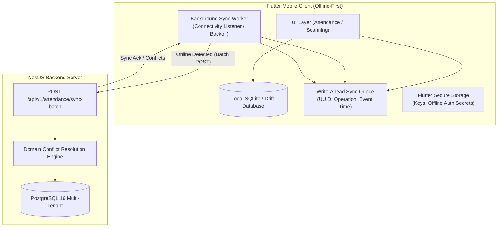
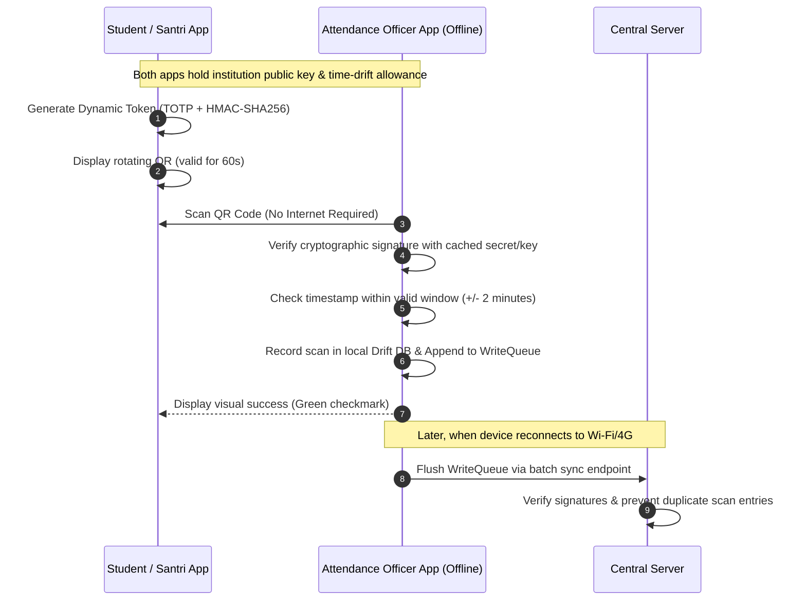

# Offline-First & Data Synchronization Protocol

## 1. Overview & Mobile Architecture

Educational institutions and pesantren often operate in environments with intermittent, low-bandwidth, or absent cellular/Wi-Fi connectivity (e.g., dormitory gates, sports fields, rural campus branches). 

The mobile application (Flutter) is engineered from the ground up as an **Offline-First system** using **SQLite** managed through the **Drift** reactive persistence library.



---

## 2. Local Database Schema (Drift / SQLite)

The mobile client maintains two core local data stores:
1. **Local Mirror Cache**: Read-only copies of active students, classes, subjects, dorm rooms, and academic periods.
2. **Local Sync Queue (`sync_queue`)**:
   ```sql
   CREATE TABLE sync_queue (
       id TEXT PRIMARY KEY,             -- UUIDv4 generated locally at event creation
       tenant_id TEXT NOT NULL,
       operation_type TEXT NOT NULL,    -- ATTENDANCE_SCAN, LEAVE_REQUEST, TAHFIZ_ENTRY
       payload TEXT NOT NULL,           -- Encrypted JSON representation of payload
       event_timestamp INTEGER NOT NULL, -- Unix timestamp (milliseconds) when action occurred
       created_at INTEGER NOT NULL,
       retry_count INTEGER DEFAULT 0,
       status TEXT NOT NULL,            -- PENDING, SYNCING, FAILED, CONFLICT
       error_message TEXT
   );
   ```

---

## 3. Cryptographically Signed Dynamic QR Attendance

To allow secure offline attendance without an active internet connection to the central server, the platform implements **Cryptographically Signed QR Tokens**:



### QR Token Payload Structure:
```json
{
  "t": "9b1deb4d-3b7d-4bad-9bdd-2b0d7b3dcb6d",   // Tenant ID
  "s": "c7a8b9f0-21a4-4e78-9b8e-1f7c2e3d4a5b",   // Student ID
  "ts": 1794375600,                               // Issue timestamp
  "n": "a8f3b2c1",                                // Nonce
  "sig": "f8a7e4...6b9d"                          // HMAC-SHA256 signature
}
```

---

## 4. Conflict Resolution Rules by Domain

| Domain | Conflict Scenario | Resolution Strategy |
| :--- | :--- | :--- |
| **Attendance Scans** | Multiple scans recorded for the same student on the same date/session while devices were offline. | **Deduplication / Earliest Check-in**: The server acknowledges the earliest verified check-in timestamp and ignores duplicates. |
| **Financial Transactions** | Duplicate cash payments recorded on conflicting devices. | **Strict Failure & Manual Audit**: **NEVER** overwrite financial records silently. Conflicting financial transactions are flagged as `NEEDS_RECONCILIATION` and require Treasurer approval. |
| **Leave Requests** | Officer approves leave offline while another officer rejects it on web. | **Server Authority / Status Precedence**: Central server status overrides offline change if server updated first. |
| **Master Data** | Student info updated on server while offline client holds older version. | **Server Authority**: Client mirror cache is updated on next heartbeat sync. |

---

## 5. Synchronization Lifecycle & Failure Handling

1. **Connectivity Detection**:
   - The Flutter mobile client listens to `connectivity_plus` events.
   - When an active network is detected, the `SyncManager` triggers a sync heartbeat.
2. **Batch Processing**:
   - Items in `sync_queue` with status `PENDING` are bundled in chunks of 50.
   - Dispatched to `POST /api/v1/attendance/sync-batch` with `Idempotency-Key`.
3. **Exponential Backoff**:
   - Failed attempts increment `retry_count`.
   - Delays follow exponential backoff: $2^n \times 1000\text{ms}$ up to a maximum of 5 minutes.
4. **Safe Logout Protection**:
   - If a user attempts to log out while `sync_queue` contains un-synced operations, the mobile app displays a modal warning showing the pending count.
   - Logout is blocked until the queue is flushed or the user explicitly acknowledges data risk with secondary confirmation.
