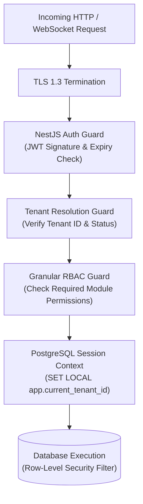

# Security & Data Privacy Architecture

## 1. Security Principles

The **Integrated School & Pesantren Management SaaS** platform is designed under a **Zero-Trust** security architecture. Every incoming request is authenticated, authorized, tenant-scoped, and validated.

---

## 2. Multi-Tenant Isolation Guarantees

Data isolation between schools and pesantren is our highest non-negotiable security priority.

### Defense-in-Depth Measures:
1. **Application Layer**: NestJS global guards verify that the authenticated user belongs to the requested `tenant_id`. Cross-tenant manipulation returns `403 Forbidden` immediately.
2. **Database Layer (RLS)**: PostgreSQL Row-Level Security policies are active on all tenant-owned tables. Even if application code misses a `where: { tenantId }` filter, PostgreSQL returns zero rows from other tenants.
3. **Storage Layer**: Object storage files (images, PDFs, documents) are stored with tenant-specific prefixes:
   `s3://edusaas-documents/tenants/{tenant_id}/{module}/{year}/{file_id}.ext`
   Pre-signed URLs with short expirations (e.g., 15 minutes) are required for all downloads.

---

## 3. Authentication & Token Lifecycle

### 3.1 Token Strategy
- **Access Tokens**: Short-lived (15 minutes). Cryptographically signed with RS256 or HMAC SHA-256. Contains `sub` (user_id), `tenant_id`, `roles`, and session fingerprint.
- **Refresh Tokens**: Long-lived (7 days). Stored hashed in the database and validated against Redis active sessions.
- **Refresh Token Rotation (RTR)**: Every time a refresh token is exchanged for a new access token, the old refresh token is invalidated and a new one is issued. If a revoked refresh token is presented, the entire token family is immediately purged (breach detection).

### 3.2 Password Hashing & Brute-Force Prevention
- Passwords are salted and hashed using **bcrypt** with a cost factor of 12 (or Argon2id).
- Consecutive failed logins trigger exponential delay and temporary account locking via Redis rate limiters.
- Privileged roles (Super Admin, Principal, Treasurer) support Time-based One-Time Password (TOTP) Multi-Factor Authentication (MFA).

---

## 4. Indonesian Data Privacy Compliance (UU PDP No. 27/2022)

The system is architected to comply with the Indonesian Personal Data Protection Law (**Undang-Undang No. 27 Tahun 2022 tentang Pelindungan Data Pribadi**):

1. **Child & Student Data Protection (Pasal 25 UU PDP)**:
   - Processing of student/child personal data requires verifiable consent from verified parents or legal guardians.
   - Student NIK and NISN are encrypted in storage using AES-256 encryption.
2. **Dedicated Restricted Counseling Records**:
   - Counseling (*Bimbingan Konseling / BK*) and student violation notes are classified as sensitive personal data.
   - Access is cryptographically and procedurally restricted strictly to assigned counselors and the Head of School. Other staff members cannot view counseling notes.
3. **Data Retention & Right to Erasure**:
   - Automated retention schedules purge transient logs after 365 days.
   - Data export and right-to-be-forgotten workflows allow institutions to sanitize personal records when students graduate or transfer.
4. **Encryption in Transit & at Rest**:
   - Enforced TLS 1.3 with modern cipher suites for all network communications.
   - Database volumes, backups, and object storage are encrypted at rest using AES-256.

---

## 5. Input Sanitization & Attack Mitigation

| Vulnerability | Mitigation Strategy |
| :--- | :--- |
| **SQL Injection** | Parameterized queries via Prisma ORM and strict RLS. Zero raw string interpolation. |
| **Cross-Site Scripting (XSS)** | React automatic JSX escaping, DOMPurify for rich text, strict Content Security Policy (CSP). |
| **CSRF** | SameSite=Lax/Strict cookie configuration, Bearer Authorization headers on API calls. |
| **File Upload Exploits** | Strict MIME-type validation, magic byte header verification, file size limits (max 10MB), randomized storage filenames. |
| **Denial of Service (DoS)** | IP and Tenant rate-limiting via `@nestjs/throttler` backed by Redis counters. |

---

## 6. Audit Trails & Accountability

Every critical administrative and financial action is recorded to an append-only `audit_logs` table:
- Captured attributes: `tenant_id`, `user_id`, `action`, `resource`, `resource_id`, `before_snapshot`, `after_snapshot`, `ip_address`, `user_agent`, `timestamp`.
- Audit records cannot be modified or deleted through application APIs.
