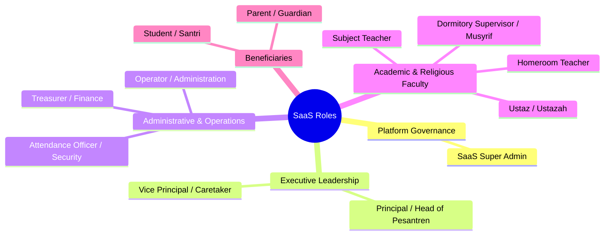
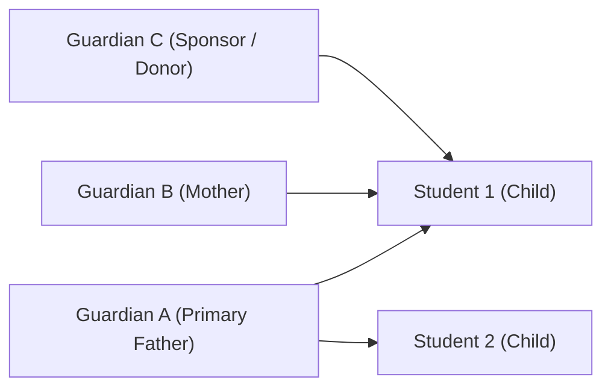

# User Roles & Granular RBAC Permissions Specification

## 1. Overview & Multi-Role Architecture

The platform provides a flexible, enterprise-grade **Role-Based Access Control (RBAC)** engine.

### Core RBAC Principles:
- **Multi-Role Accounts**: A single user account can hold multiple roles simultaneously (e.g., an individual who is both a *Subject Teacher* and a *Musyrif*, or an *Operator* who is also a *Parent*).
- **Active Role Switching**: In the mobile and web interface, users with multiple roles can seamlessly switch active contexts or view an aggregated workspace.
- **Granular Actions**: Permissions are not monolithic. Each module supports distinct actions: `view`, `create`, `update`, `delete`, `approve`, `reject`, `export`, `print`, and `manage`.
- **Tenant Scope Enforcement**: Permissions are evaluated strictly within the context of the active tenant.

---

## 2. The 12 Initial System Roles

### 1. SaaS Super Admin
- Platform owner and technical maintainer.
- Manages tenants, subscriptions, module feature flags, system health, and cross-tenant backups.
- Does not inspect tenant business operational data without explicit tenant permission.

### 2. Principal / Head of Pesantren (*Kepala Sekolah / Pengasuh Pondok*)
- Executive leadership across formal school and pesantren units.
- Complete read access to all institutional analytics, academic rankings, and financial summaries.
- Final approval authority on expulsions, high-value disbursements, and graduation.

### 3. Vice Principal / Caretaker (*Wakil Kepala Sekolah / Wakil Pengasuh*)
- Operational oversight of curriculum, student affairs, infrastructure, and Islamic traditions (*ke-pesantrenan*).
- Approves student dispensations, academic calendars, and event schedules.

### 4. Operator / Administration (*Tata Usaha*)
- Day-to-day administrative data entry and records maintenance.
- Enters student profiles, class rosters, teacher assignments, and academic periods.
- Generates official letters, student mutasi, and government data sync exports.

### 5. Treasurer / Finance (*Bendahara Sekolah & Pesantren*)
- Complete financial management.
- Manages billing rates, SPP tuition, infak, dormitory fees, and custom categories.
- Records manual cash receipts, reconciles bank/QRIS payments, and prepares financial ledgers and balance sheets.

### 6. Homeroom Teacher (*Wali Kelas*)
- Manages a designated class section / rombel.
- Monitors attendance trends, compiles student semester grade sheets, writes soft-skill evaluations, and issues report cards (*Rapor*).

### 7. Subject Teacher (*Guru Mata Pelajaran*)
- Enters grades, assignments, learning materials, and class attendance for assigned subjects.
- Prepares online examination question banks.

### 8. Ustaz / Ustazah (*Pengajar Diniyah & Kitab Kuning*)
- Teachers responsible for religious pesantren subjects, Sorogan, Bandongan, and Diniyah curricula.
- Records student recitation marks and religious comprehension.

### 9. Dormitory Supervisor / Musyrif (*Pembina Asrama*)
- Oversees student boarding life, dorm cleanliness, curfew, and Islamic prayer attendance.
- Logs Tahfiz/Tahsin Quran memorization, halaqah attendance, and dorm leave permissions.

### 10. Attendance Officer / Security (*Petugas Presensi / Satpam*)
- Operates mobile or stationary barcode/QR attendance scanners at school gates and dorm entries.
- Verifies visitor entry and student exit permissions.

### 11. Student / Santri
- Accesses digital student ID, dynamic QR code for attendance, daily schedule, and learning materials.
- Submits homework, takes online exams, and views academic report cards and Tahfiz logs.

### 12. Parent / Guardian (*Wali Santri / Orang Tua*)
- Monitors children's real-time check-in/out timestamps, grades, prayer attendance, and health logs.
- Views tuition invoices, makes online payments via QRIS/VA, and requests student sick leave.

---

## 3. Granular Permission Matrix (Summary)

| Module | Super Admin | Principal | Operator | Treasurer | Teacher | Musyrif | Security | Student | Parent |
| :--- | :---: | :---: | :---: | :---: | :---: | :---: | :---: | :---: | :---: |
| **Tenant Settings** | Manage | View | View | - | - | - | - | - | - |
| **Master Data** | Manage | View | Manage | - | View | View | View | - | - |
| **Attendance** | View | View/Approve | View | - | Manage | Manage | Scan/Record | View Own | View Child |
| **Finance & Billing** | - | View | View | Manage | - | - | - | View Own | View/Pay* |
| **Academic Grades** | - | Approve | View | - | Manage | - | - | View Own | View Child |
| **Pesantren/Tahfiz** | - | View | View | - | - | Manage | - | View Own | View Child |
| **Dormitory Leaves** | - | View | - | - | - | Approve | Verify | View Own | Request/View |
| **Counseling (BK)** | - | View | - | - | Assigned | - | - | - | - |

*\*Subject to guardian financial access configuration.*

---

## 4. Guardian Relationships & Access Controls

The platform handles complex, real-world family dynamics:

### Relationship Rules:
1. **1 Guardian to Many Students**: A parent with multiple children across different classes or grades manages all of them within a single login account.
2. **Many Guardians to 1 Student**: A student may have multiple linked guardians (father, mother, legal guardian, elder sibling, or foundation sponsor).
3. **Primary vs. Secondary Guardians**:
   - The primary guardian is the primary emergency contact and legal signatory.
4. **Segmented Financial Restrictions**:
   - The system supports restricting financial details per guardian link. For example, a sponsor may have permission to pay tuition without viewing personal counseling notes, or a secondary guardian can view attendance without access to the financial billing ledger.
5. **Independent Notification Preferences**:
   - Each linked guardian configures independent push/WhatsApp notification channels (e.g., Mother receives check-in alerts; Father receives billing reminders).
